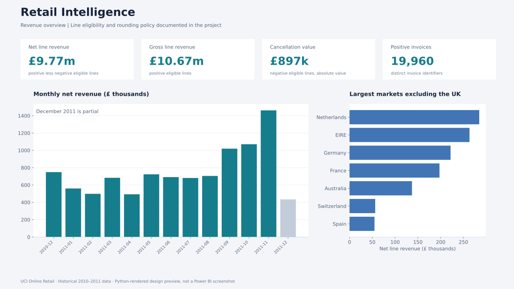

# Retail Intelligence for Power BI

**A transaction-to-dashboard portfolio project covering revenue, cancellations, customer retention and demand forecasting.**

Native PBIP/PBIR source • TMSL semantic model • Power Query • 37 DAX measures • SQL reconciliation • Python forecasting



*Preview rendered in Python from the project's measured results. It is not a screenshot of Power BI Desktop.*

## Business questions

- How do positive sales and negative cancellation lines reconcile to net line revenue?
- Which stock descriptions and markets account for revenue and cancellation value?
- How do known-customer cohorts retain activity after their first observed purchase?
- Does a forecasting model beat a weekly seasonal baseline on an untouched period?
- How would contribution change under an explicitly hypothetical variable-cost ratio?

## Measured results

| Metric | Result |
| --- | ---: |
| Original transaction lines | 541,909 |
| Eligible transaction lines | 539,392 |
| Gross line revenue | £10,666,684.54 |
| Cancellation line value | £896,812.49 |
| Net line revenue | £9,769,872.05 |
| Positive invoice IDs | 19,960 |
| Known purchasing customers | 4,338 |
| Countries | 38 |

Figures follow the documented eligibility policy and line-level rounding. The source contains fees and administrative stock codes as well as merchandise. Negative lines are credits/cancellations, not proof of physical returns. No costs, profit or realised business improvement are present in the source.

## Explore the project

| Component | Open |
| --- | --- |
| Native Power BI project | [RetailIntelligence.pbip](powerbi/RetailIntelligence.pbip) |
| Four-page report source | [Report definitions](powerbi/RetailIntelligence.Report/definition/pages) |
| Semantic model and measures | [model.bim](powerbi/RetailIntelligence.SemanticModel/model.bim) · [DAX catalogue](docs/MEASURES.dax) |
| Findings and decisions | [FINDINGS.md](reports/FINDINGS.md) |
| Data model and metric definitions | [ARCHITECTURE.md](docs/ARCHITECTURE.md) |
| Original data, licence and checksum | [DATA_SOURCE.md](docs/DATA_SOURCE.md) |
| Opening and validating in Desktop | [DESKTOP_SETUP.md](docs/DESKTOP_SETUP.md) |
| Automated checks and limits | [VALIDATION.md](docs/VALIDATION.md) |

## Four report pages

1. **Revenue overview:** revenue KPIs, monthly trends, country and month slicers, reconciliation control.
2. **Customers and cohorts:** known-customer measures, snapshot segments, complete-month retention matrix. Cohorts deliberately remain global and do not respond to the customer segment slicer.
3. **Products and cancellations:** dynamic top-product ranking, cancellation rates, product detail and country filtering.
4. **Forecast and cost scenario:** held-out error comparison, historical-origin scenario forecasts and a disconnected cost-ratio selector.

[Customer preview](reports/cohort-preview.svg) · [Product preview](reports/product-preview.svg) · [Forecast preview](reports/forecast-preview.svg)

## Reproduce

Python 3.12 was used. From this project folder:

```bash
python -m venv .venv
# macOS/Linux
source .venv/bin/activate
# Windows PowerShell: .venv\Scripts\Activate.ps1
python -m pip install -r requirements.txt
python scripts/download_data.py
python scripts/build_data.py
python scripts/build_powerbi.py
python scripts/validate_pbir.py
python -m unittest discover -s tests -v
python scripts/render_preview.py
```

The source workbook is approximately 23 MB and the generated import CSVs approximately 29 MB. They are downloaded/generated locally rather than committed.

On **Windows with Power BI Desktop**, run `python scripts/configure_powerbi.py`, open `powerbi/RetailIntelligence.pbip`, and refresh. Import `powerbi/RetailTheme.json` through View → Themes if desired. Desktop, DAX execution and Power Query refresh were **not available for verification in the authoring environment**. A packaged `.pbix` is not supplied.

## Validation status

| Check | Status |
| --- | --- |
| Data transformation and SQL marts | Executed |
| Eight data/model integrity tests | Passed |
| 39 PBIP/PBIR definitions against Microsoft JSON schemas | Passed |
| Four analytical design previews | Rendered and reviewed |
| Native report rendering, DAX execution and Power Query refresh | Requires Power BI Desktop verification |
| Power BI Service publishing and access controls | Not deployed |

## Forecast conclusion

The model's 28-day holdout MAE is **£12,286.93/day**, against **£11,119.16/day** for lag-7. The model is **10.5% worse**. Retain the seasonal baseline for this benchmark. Recursive future values are a historical-origin scenario, not a current forecast or a guaranteed prediction interval.

## Attribution and portfolio use

Public dataset: Chen, D. (2015), *Online Retail*, UCI Machine Learning Repository, [DOI 10.24432/C5BW33](https://doi.org/10.24432/C5BW33), CC BY 4.0. Analysis and derived outputs are adaptations; see the data-source record.

Independent portfolio work created with AI assistance. Review, run and personalise it before discussing it in interviews. It does not represent employer delivery or production deployment. Code is [MIT licensed](LICENSE); data attribution is separate.
